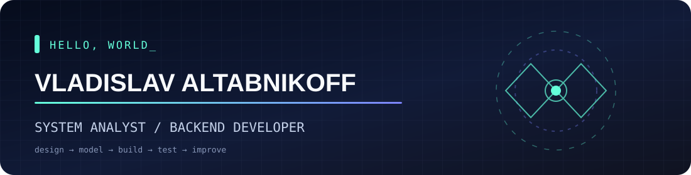

 

## 👋 About me

I'm **Vladislav Altabnikoff**, exploring **system analysis** and **backend development** through practical projects. I work with API contracts, data models, business processes, service integrations and automated testing.

- 🧩 **System analysis:** functional requirements, BPMN, UML, sequence diagrams, API specifications
- ⚙️ **Backend & integrations:** Java, Spring, REST APIs, JSON Schema, Kafka, RabbitMQ
- 🗃️ **Data:** PostgreSQL, SQL, relational modeling, migrations, query optimization
- 🧪 **Testing:** Postman, Selenium, TestNG, Appium
- 🛠️ **Engineering tools:** Git, GitHub, Docker, DBeaver, VS Code, PlantUML, draw.io, Jira, Confluence

## 🧰 Tech stack

**Backend & data**

**Development tools**

**Architecture, integrations & QA**

## 🚀 Featured project

### 🌿 EcoBooking — booking platform

A practical booking platform project involving reservation workflows, user experience and integrations.

**Repository:** `gvroffskii/ecobooking` — currently private; code is visible only to authorized collaborators.

## 📊 GitHub activity

 

## 🐍 Contribution snake

<picture>
<source media="(prefers-color-scheme: dark)" srcset="https://raw.githubusercontent.com/gvroffskii/gvroffskii/output/github-contribution-grid-snake-dark.svg" />
<source media="(prefers-color-scheme: light)" srcset="https://raw.githubusercontent.com/gvroffskii/gvroffskii/output/github-contribution-grid-snake.svg" />

</picture>

<!-- Statistics rely on external services, which may sometimes be temporarily unavailable. -->